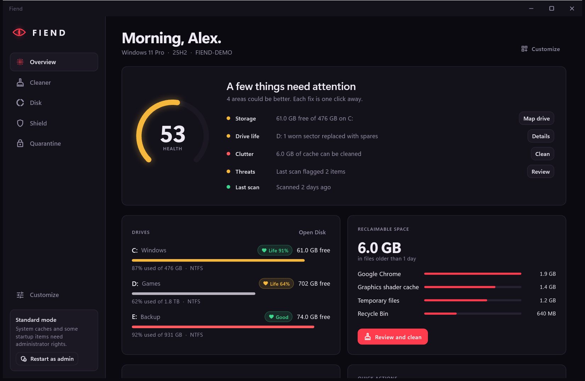
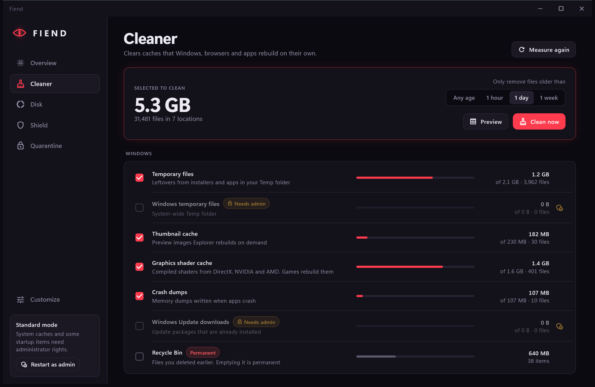
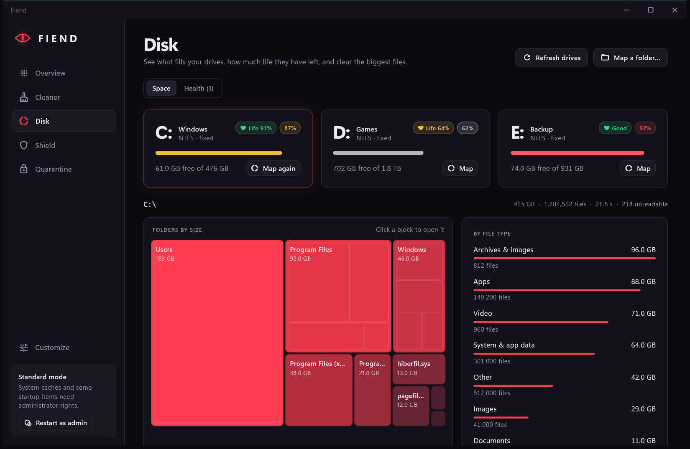
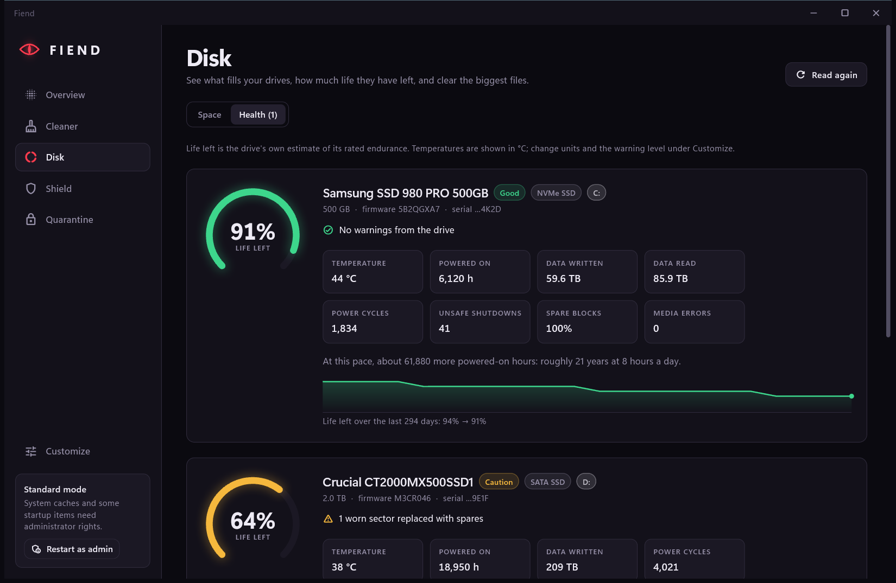
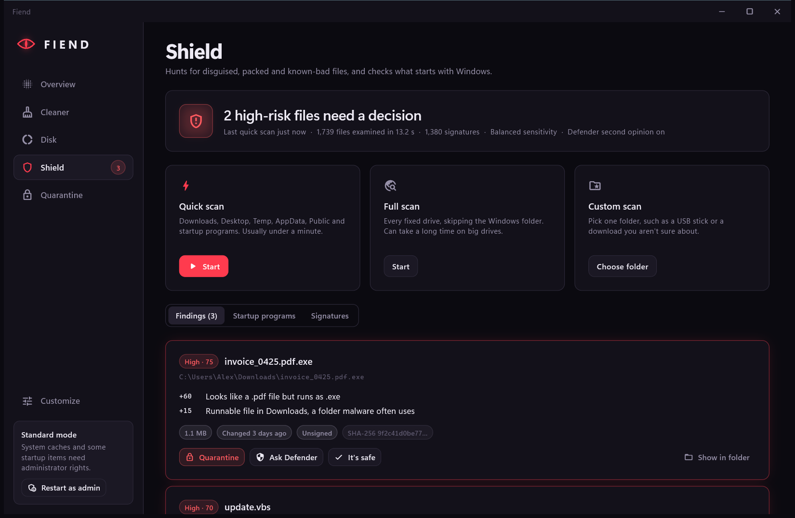
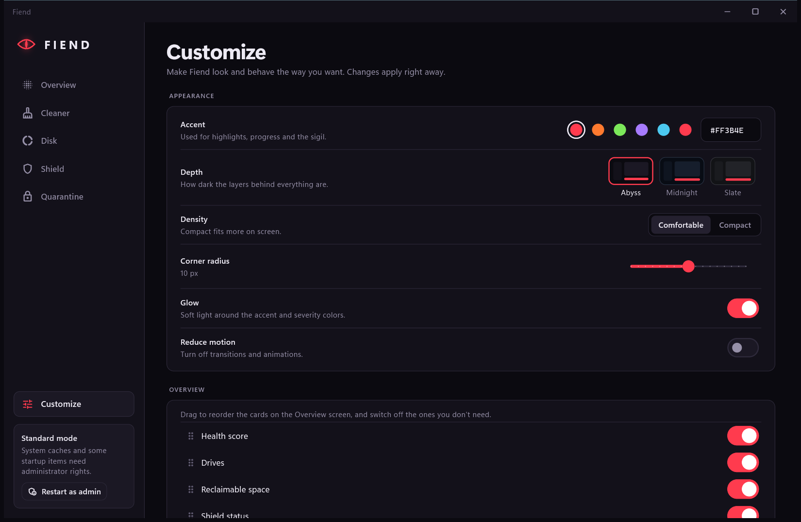
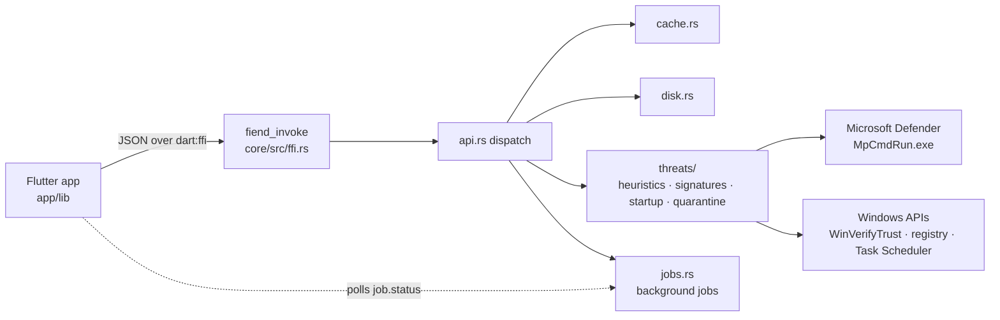

<p align="center">
  
</p>

<h1 align="center">Fiend</h1>

<p align="center">
  <b>It hunts what hides on your PC.</b><br>
  Clean caches, map your disks, and catch disguised, packed and known-bad files on Windows.
</p>

<p align="center">
  <a href="https://fiend-delta.vercel.app"></a>
  
  
  
  
</p>

<p align="center">
  <a href="https://fiend-delta.vercel.app/#download"><b>Download</b></a> ·
  <a href="#screenshots">Screenshots</a> ·
  <a href="#how-shield-decides">How Shield decides</a> ·
  <a href="#build-from-source">Build from source</a>
</p>

<p align="center">
  
</p>

## Contents

1. [Features](#features)
2. [Screenshots](#screenshots)
3. [How Shield decides](#how-shield-decides)
4. [Make it yours](#make-it-yours)
5. [Download and install](#download-and-install)
6. [Build from source](#build-from-source)
7. [How it fits together](#how-it-fits-together)
8. [Project layout](#project-layout)
9. [Website](#website)
10. [Safety and limits](#safety-and-limits)

## Features

| | What it does |
| --- | --- |
| **Overview** | One health score built from free space, reclaimable cache, open threats and scan age, with a one-click fix next to each. |
| **Cleaner** | Measures 13 cache locations: Temp, Windows Update downloads, thumbnails, shader caches, crash dumps, error reports, the Recycle Bin, and Chrome, Edge, Brave and Firefox. It keeps files newer than a day by default, skips files in use, and previews the total before deleting. |
| **Disk** | Maps a drive or folder in parallel: a treemap of the biggest folders, space by file type, and the largest files with Reveal and Recycle Bin actions. OneDrive placeholders count as 0 bytes. |
| **Drive health** | Reads each drive's own health data: life left, temperature, hours powered on, data written, power cycles and bad sectors, with a Good, Caution or Bad verdict and a wear trend recorded once a day. NVMe drives work without admin rights; SATA SMART data needs admin. |
| **Shield** | Scores files 0–100 using evidence you can read, checks a SHA-256 blocklist (MalwareBazaar or your own), verifies Authenticode signatures, reviews everything that starts with Windows, and asks Microsoft Defender about anything serious. |
| **Quarantine** | Flagged files are moved into a vault with their bytes scrambled so they can't run. Restore puts them back exactly where they were. |
| **Customize** | Accent, depth, density, corners, glow, motion, Overview card order, and every scan and clean rule. |

## Screenshots

<table>
  <tr>
    <td width="50%"><br><sub><b>Cleaner</b>: preview, then clean, with recent files kept</sub></td>
    <td width="50%"><br><sub><b>Disk</b>: treemap, file types and largest files</sub></td>
  </tr>
  <tr>
    <td colspan="2"><br><sub><b>Drive health</b>: life left, the numbers behind it, and wear over time</sub></td>
  </tr>
  <tr>
    <td width="50%"><br><sub><b>Shield</b>: every finding shows its reasons</sub></td>
    <td width="50%"><br><sub><b>Customize</b>: changes apply live</sub></td>
  </tr>
</table>

Screenshots come from `Fiend.exe --demo`, which runs on sample data.

## How Shield decides

Each signal adds points, and a file is reported once its score reaches your sensitivity threshold:
**Relaxed 50+**, **Balanced 30+** (default) or **Paranoid 15+**. Scores of 40 and up are medium, 70 and up are high.

| Signal | Example | Points |
| --- | --- | ---: |
| Known-bad SHA-256 hash | On the MalwareBazaar feed or your own list | 100 |
| Microsoft Defender detection | Asked for every medium and high finding | 100 |
| Right-to-left override in the name | `cv` + hidden `U+202E` + `fdp.exe` reads as `cvexe.pdf` | +70 |
| Document name, program extension | `invoice.pdf.exe` | +60 |
| Program code behind a picture or document name | `holiday.jpg` that starts with `MZ` | +55 |
| Ransomware-style script commands | `vssadmin delete shadows` | up to +45 |
| Spaces hiding the real extension | `photo.jpg      .scr` | +40 |
| Invalid or untrusted signature | Tampered or self-signed program | +35 |
| Hidden system file in your user folder | Executable with Hidden and System set | +30 |
| Packed or encrypted contents | Entropy above 7.2 bits per byte | +20 |
| No digital signature | Only counted in risky folders | +20 |
| Runnable file in a risky folder | Downloads, Temp, loose in AppData, Public, Startup | +15 |
| Expired signature | Old but genuine installers | +10 |
| Signed by a verified publisher | Checked with Windows' own WinVerifyTrust | −40 |

The rules live in [`core/src/threats/heuristics.rs`](core/src/threats/heuristics.rs) and
[`core/src/threats/startup.rs`](core/src/threats/startup.rs).

## Make it yours

- **Accent**: Hellfire, Ember, Toxic, Spectral, Ice, or any hex color
- **Depth**: Abyss, Midnight or Slate
- **Layout**: comfortable or compact density, 2–18 px corners, glow on or off, reduced motion
- **Overview**: reorder or hide every card
- **Cleaner**: age limit, your own cache folders, folders to never touch
- **Shield**: sensitivity, extra quick-scan folders, exclusions, trusted files, Defender on or off, scan on launch, auto-quarantine for high risk

Settings live in `%APPDATA%\Fiend\settings.json`.

## Download and install

Get the latest build from **[fiend-delta.vercel.app](https://fiend-delta.vercel.app/#download)**:

- **Installer** (`Fiend-1.1.0-setup.exe`): per user, no admin rights. Installs to
  `%LOCALAPPDATA%\Programs\Fiend` with a Start menu shortcut. The uninstaller keeps your
  settings and quarantine unless you tick the box to remove them.
- **Portable zip** (`Fiend-1.1.0-win-x64.zip`): unzip anywhere and run `Fiend.exe`.

Fiend isn't code-signed yet, so SmartScreen may warn on first run: choose **More info**, then
**Run anyway**. The site lists the SHA-256 of both files; check yours with
`Get-FileHash .\Fiend-1.1.0-setup.exe`.

Requires Windows 10 or 11, 64-bit. Run as administrator to clean system-wide caches.

## Build from source

You need:

- Rust with the MSVC toolchain
- Flutter 3.47+ with Windows Developer Mode on
- Visual Studio with "Desktop development with C++"
- Inno Setup 6.6+ for the installer (`winget install JRSoftware.InnoSetup`)

```powershell
.\scripts\build.ps1          # tests, release build, installer + zip into web\downloads
```

Or step by step:

```powershell
cd core; cargo test; cd ..
cd app; flutter test; flutter run -d windows     # cargo builds the DLL automatically
```

Useful flags:

```powershell
Fiend.exe --demo                          # sample data, touches nothing on this PC
Fiend.exe --demo --section=shield         # open a screen: overview, cleaner, disk, health, shield, quarantine, settings
Fiend.exe --demo --accent=toxic           # hellfire, ember, toxic, spectral, ice
```

Drive the engine from the command line (set `FIEND_DATA_DIR` to keep test runs away from your
real settings and quarantine):

```powershell
cd core
cargo run --bin fiend-cli -- drives.list
cargo run --bin fiend-cli -- job cache.analyze
cargo run --bin fiend-cli -- job shield.scan "{\"mode\":\"quick\"}"
```

The app icon and installer artwork are drawn from the sigil by `node scripts/make-icon.mjs`;
the repo banner comes from `scripts/make-banner.ps1`.

## How it fits together



The app calls one C function, `fiend_invoke`, which takes and returns JSON
([`core/src/api.rs`](core/src/api.rs) lists every method). Long work such as scans and disk
mapping runs as engine jobs that the app polls for progress, so the window never blocks.

## Project layout

```
app/                 Flutter Windows app (screens, theme, engine bridge)
core/                Rust engine: fiend_core.dll + fiend-cli
design/tokens.json   shared colors, radii and type for the app and the website
installer/           Inno Setup script and wizard artwork
scripts/             build.ps1, make-icon.mjs, make-banner.ps1, capture.ps1, serve.mjs
web/                 static download site, deployed to Vercel
```

## Website

`web/` is a static site. Preview it with `node scripts/serve.mjs` at http://localhost:4173 and
deploy from the `web` folder with `npx vercel deploy --prod`. `scripts/build.ps1` refreshes
`web/downloads/` (installer, zip and `release.json`), which is kept out of git; screenshots in
`web/assets/` come from `scripts/capture.ps1` running the app in `--demo` mode.

## Safety and limits

- Fiend never deletes a flagged file on its own. Quarantine is reversible.
- Disk deletions go to the Recycle Bin; cleaning keeps recent and in-use files.
- Scanning happens on your PC. The only network request is the optional download of
  MalwareBazaar's public hash list.
- Shield is heuristic and signature-based. It catches common tricks, but it isn't a full
  antivirus, so keep Windows Security turned on.
